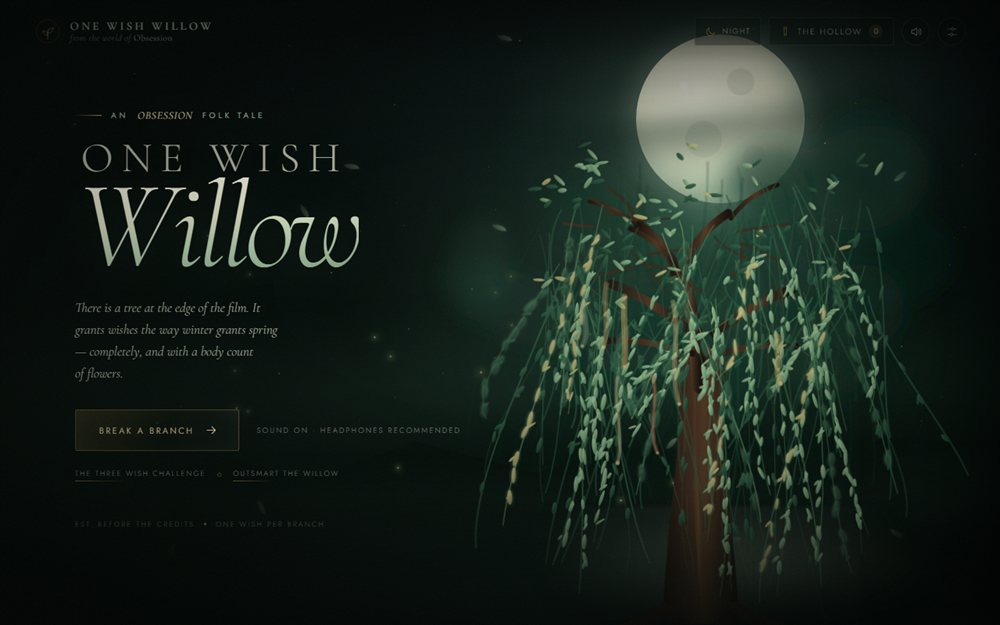

# One Wish Willow




A cinematic, single-page wish-granting experience inspired by **Obsession**.

You write a wish. You hold the branch until it bends. It snaps, the grove goes quiet,
and the willow answers — first with the wish granted, then with four escalating
consequences and a price you did not agree to.

No frameworks, no build step, no audio files. The tree is generated SVG, the sound is
synthesised with the Web Audio API, and the story engine is plain JavaScript.

---

## Run it

Open `index.html` directly in a modern browser, or serve the folder:

```powershell
# from this folder
python -m http.server 8080
# then open http://localhost:8080
```

Sound starts after you click **Break a branch** (browsers require a gesture).
Use headphones if you have them.

---

## What happens

1. **The grove** — an animated willow, moon/sun, fog, fireflies, falling leaves and grain.
2. **The hours** — the light button in the top bar cycles through **Night → Dawn →
   Day → Dusk**. Each hour repaints the sky, sun, hills, mist and tree, and the
   choice is remembered on this device.
3. **The offering** — type a wish, hold the branch for ~1.2 seconds, and it snaps
   with a crack, a flash, a screen shake and a burst of leaves.
4. **The answer** — the wish is quoted back in the second person, followed by:
   - **Granted** — a literal, sideways interpretation of the wish.
   - **The Spiral** — three domain-specific cracks plus a universal last turn.
   - **The Cascade** — each crack splits into five child drawbacks, drawn as a
     branching tree. One consequence becomes a weather system.
   - **The Slow Burn** — the same wish at **one week, one month, one year and ten
     years**. The first entry is almost lucky. The last one has a face.
   - **The Price** — the cost, a debt meter, and classification tags.
5. **The Hollow** — every wish is kept in `localStorage` on this device. Open the
   archive from the top bar to re-read old fates. Clear them with a two-tap confirm.

Every result is generated fresh from the wording: intent detection chooses one of
21 story domains (love, money, fame, beauty, power, revenge, mortality, time,
health, family, memory, truth, freedom, luck, ambition, superpowers, the world,
belonging, happiness, pets, or the unnamed), then the engine picks an opening,
a middle and a final crack, a coda, a price and a debt score. Cascades and
timelines are derived deterministically from that same record, so a saved wish
always grows the same roots.

### The bargaining modes

- **Wish Negotiation** — re-word the wish and watch the loophole-proof score move
  in real time. Numbers, deadlines, exit clauses, no-collateral language and
  explicit definitions raise the score; absolutes, vague nouns and stacked
  “and”s lower it. Submit the revision and the willow issues a counter-offer,
  a reduced visible-crack count, a new debt and the residual loophole you did
  not close. It always finds one.
- **The Three Wish Challenge** — make three wishes. The second and third must
  explicitly select a drawback from the previous wish to undo. Each repair adds
  to a running **corruption score**; the final verdict grades the damage.
  Crisis wishes stop the challenge and show real support links instead.
- **Outsmart the Willow** — a Hall of Fame for the most airtight wording.
  Nominations open a pre-filled GitHub issue; votes are the reactions on that
  issue. The page reads public issues through the GitHub API. Four curated
  house exhibits sit outside the vote.

Small details are read from the exact sentence: absolutes ("never", "forever"),
hedging ("maybe"), minimisers ("just"), multiple hungers ("and"), wishes made for
someone else, and the second-person transcription of what the willow wrote down.

Wishes about self-harm are detected and answered with a gentle, non-fictional
response and real support links instead of a horror story. Nothing is sent
anywhere.

---

## Files

```
index.html              markup and inline SVG sprite
css/style.css           all styling, atmosphere, responsive layout
js/wish-data.js         the story domains, twists, prices, codas, observations
js/wish-engine.js       intent matching, generation, copy formatting
js/wish-expansion.js    cascades, timeline, negotiation scoring, challenge maths
js/modes.js             negotiation, three-wish run, Hall of Fame and voting
js/willow-art.js        generative SVG willow, stars, fireflies, leaves
js/audio.js             procedural wind, drone, chimes, crack, whisper
js/app.js               interactions, hold-to-break, answer renderer, archive
```

---

## Controls

| Action | Control |
| --- | --- |
| Enter the grove | “Break a branch” |
| Break the branch | Press and hold the branch (or <kbd>Space</kbd>/<kbd>Enter</kbd> on it) |
| Break without holding | <kbd>Ctrl</kbd>/<kbd>Cmd</kbd> + <kbd>Enter</kbd> in the wish field |
| Change the light | Sun / moon button, top right (Night → Dawn → Day → Dusk) |
| Negotiate a wish | “Negotiate the wording” under any answer |
| Three Wish Challenge | Hero link or “The Three Wish Challenge” under any answer |
| Hall of Fame | “Outsmart the Willow” in the hero or under any answer |
| Vote in the Hall | Open a nomination and add any GitHub reaction |
| Mute / unmute | Speaker icon, top right |
| Archive | Ribbon icon, top right |
| Close overlays | <kbd>Esc</kbd> or the × |

On phones the layout becomes a bottom sheet, the suggestion chips wrap instead of
scrolling sideways, tap targets grow, and safe-area insets are respected. In
landscape the offering switches to a compact card so the branch stays reachable.

The experience respects `prefers-reduced-motion`: particles, sway and shake are
reduced, and the wish text appears instantly.

---

## Customising

- **Wishes and prices** live in `js/wish-data.js`. Add a domain with `label`,
  `cost`, `keywords`, `strong`, `granted`, four `twists`, and `prices`; the
  engine will find it automatically.
- **Debt labels / shared codas / observation rules** are at the bottom of the
  same file.
- **Colours and type** are CSS custom properties at the top of `css/style.css`;
  the four hours live in the `THE HOURS` block below the answer styles.
- **Tree density** is set by `backCount`, `midCount` and `frontCount` in
  `js/willow-art.js`.
- **Cascade children** are grouped by domain in `js/wish-expansion.js`. Add lines
  to a domain's array (or `UNIVERSAL`) and they enter the deterministic pool.
- **Hall exhibits** are the `EXHIBITS` array in `js/modes.js`. Scores are computed
  from the same loophole scorer used by negotiation.

---

## The Hall of Fame backend

There is no server. The public GitHub repository is the database:

1. Nominations create an issue labelled **`hall-of-fame`** with the wish, its
   score and a marker in the body.
2. Votes are the issue's **reactions** (`+1`, heart, hooray, etc.). The page sums
   them and links every card to the issue.
3. The page reads open labelled issues from
   `https://api.github.com/repos/Ajeet-iitk/OneWishWillow/issues?state=open&labels=hall-of-fame`.
4. If the API is unavailable or rate-limited, the last successful list is kept in
   `sessionStorage`, and the house exhibits remain visible.

To moderate, close the issue (it leaves the Hall) or delete it. To add the label
to a fork, create `hall-of-fame` under **Issues → Labels**.

---

## Live site

Published with GitHub Pages:

**https://ajeet-iitk.github.io/OneWishWillow/**

Source: **https://github.com/Ajeet-iitk/OneWishWillow**

---

*The willow is not real. The pattern is.*
